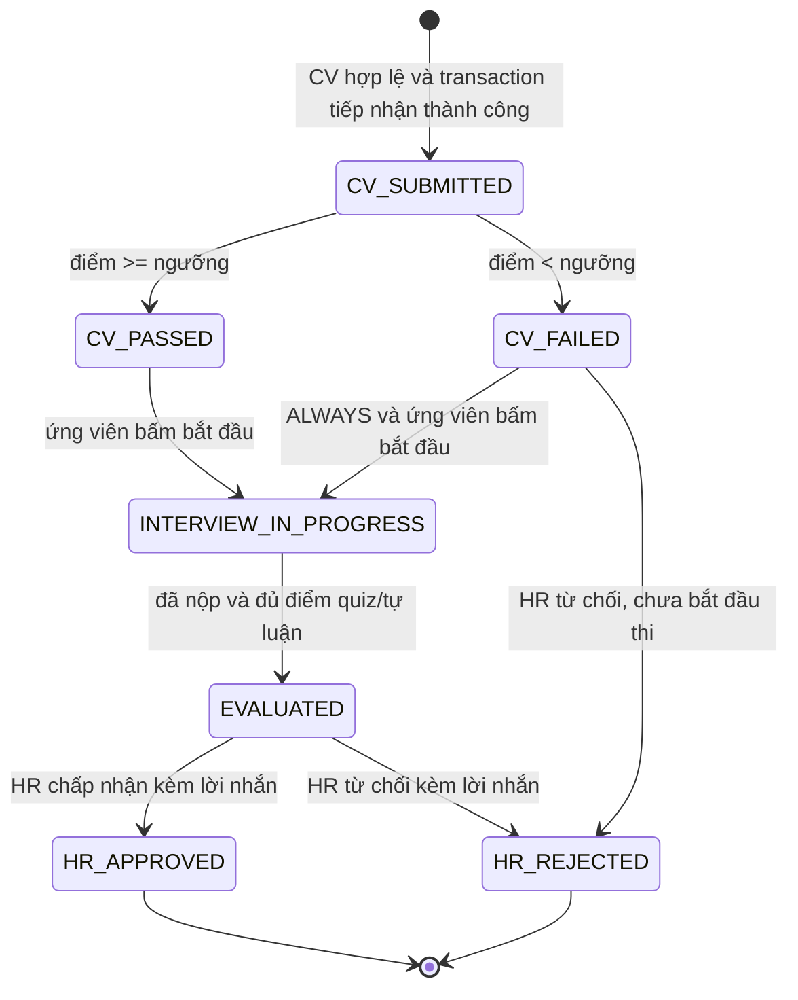
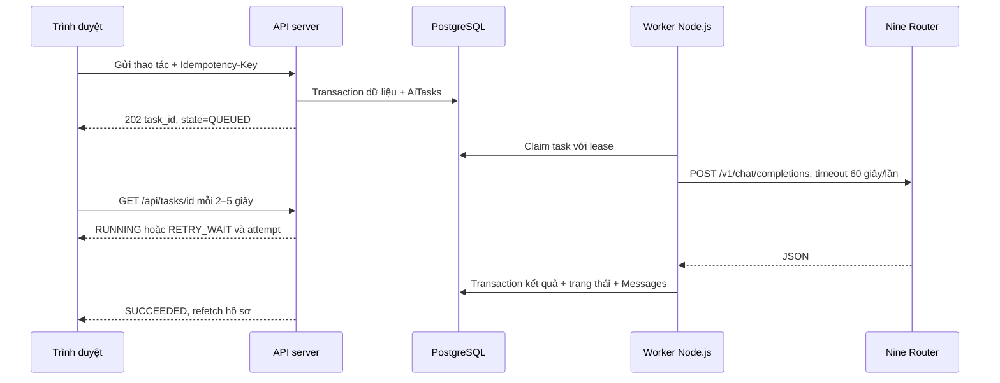

# 01 — Yêu cầu sản phẩm và luồng người dùng

Ngày lập: 02/11/2026. Trạng thái: thiết kế trước triển khai. Tài liệu này chưa tạo ứng dụng hoặc gọi dịch vụ AI thật.

## 1. Mục tiêu và phạm vi

Xây dựng nền tảng tuyển dụng có AI hỗ trợ soạn tin tuyển dụng, xây dựng thang điểm, sàng lọc CV và chấm câu trả lời tự luận. HR duyệt nội dung trước khi đăng và đưa ra quyết định tuyển dụng cuối cùng. Một tài khoản dùng được cả hai chế độ HR và ứng viên.

Phạm vi bản đầu: tài khoản cá nhân, tin tuyển dụng do cá nhân sở hữu, CV PDF/DOCX hoặc văn bản, bài kiểm tra gồm trắc nghiệm và tự luận dạng chữ, hộp thư thông báo trong ứng dụng. Chưa có tổ chức nhiều thành viên, video call, OCR tự động, email ngoài ứng dụng, thanh toán hoặc chống gian lận bằng giám sát camera.

AI chỉ hỗ trợ đánh giá theo bằng chứng nghề nghiệp. Không tự động đưa ra `HR_APPROVED` hoặc `HR_REJECTED`, không chấm theo tuổi, giới tính, dân tộc, tôn giáo, tình trạng gia đình hoặc suy đoán thông tin nhạy cảm. CV không thể đọc và lỗi dịch vụ không được coi là năng lực kém.

## 2. Quyết định sản phẩm dùng chung

| Chủ đề | Quyết định bản đầu |
| --- | --- |
| Tài khoản | Supabase Auth xác thực; `Users` lưu hồ sơ, không lưu mật khẩu |
| Chuyển chế độ | `preferred_mode` là tùy chọn điều hướng, không phải quyền truy cập; kiểm tra quyền trên server theo chủ sở hữu |
| Tự ứng tuyển | Cấm khi `Jobs.owner_user_id = current_user.id`, kể cả đổi chế độ hoặc gọi API trực tiếp |
| Nộp lại | Một hồ sơ cho mỗi cặp ứng viên/tin, một lần thi; retry kỹ thuật không tạo hồ sơ mới |
| Cấu hình bài thi | Tin đã đăng đóng băng JD, rubric, câu hỏi, thời lượng và chính sách mở khóa; muốn thay nội dung đánh giá thì tạo tin mới |
| Mở khóa | `cv_score >= pass_threshold` hoặc `interview_access_policy = ALWAYS`; luôn cần CV chấm thành công trước |
| Điểm CV | Tổng điểm tiêu chí bằng 100; server cộng điểm và quyết định đạt ngưỡng |
| Điểm bài thi | `quiz_score` và `essay_score` chuẩn hóa về 0–100; tổng `round2(quiz_score × 0.4 + essay_score × 0.6)` |
| Vai trò điểm CV | Chỉ xét điều kiện mở khóa, không cộng vào điểm bài thi; HR xem cả hai kết quả riêng |
| Hết giờ | Server đóng bài, chấm bản trả lời đã lưu gần nhất; câu bỏ trống 0 điểm |
| HR quyết định | Duyệt/chặn hồ sơ đã `EVALUATED`; hồ sơ `CV_FAILED` không được thi có thể bị HR từ chối kèm lời nhắn |
| Ngôn ngữ, thời gian | Nội dung tiếng Việt; timestamp lưu UTC, hiển thị theo múi giờ người dùng, mặc định Asia/Bangkok |

Các lựa chọn 40/60, một lần thi, 30 phút, giới hạn file và thời hạn lưu bên dưới là mặc định đề xuất để triển khai nhất quán; không phải thông tin có sẵn của Nine Router.

## 3. Màn hình và thành phần chính

| Đường dẫn dự kiến | Người dùng | Nội dung và hành động |
| --- | --- | --- |
| `/login`, `/signup`, `/forgot-password` | Khách | Đăng nhập, tạo tài khoản, xác nhận email, khôi phục mật khẩu, lỗi xác thực rõ ràng |
| `/jobs` | Mọi người | Tìm từ khóa, kỹ năng, lương, phân trang, xóa bộ lọc, trạng thái không có kết quả |
| `/jobs/[jobId]` | Mọi người | JD công khai, lương/địa điểm/kỹ năng, thời lượng thi, cách xét CV, nút ứng tuyển; chủ tin thấy liên kết quản lý |
| `/candidate/applications` | Đã đăng nhập | Danh sách hồ sơ của mình, trạng thái, ngày nộp, tiếp tục thi hoặc xem kết quả |
| `/candidate/applications/[id]` | Chủ hồ sơ | Tiến trình CV → bài thi → HR duyệt, kết quả được phép công khai, thông báo HR |
| `/jobs/[jobId]/apply` | Đã đăng nhập | Chọn file hoặc dán CV, xem và xác nhận text trích xuất, thông báo sử dụng AI, gửi CV; có application_id sau khi tiếp nhận thành công |
| `/candidate/applications/[id]/interview` | Chủ hồ sơ đủ điều kiện | Giới thiệu trước khi bắt đầu, timer, điều hướng câu hỏi, chọn đáp án, ô tự luận, dấu đã lưu, xác nhận nộp |
| `/hr` | Đã đăng nhập | Tổng quan các tin thuộc mình: số hồ sơ, chờ xử lý, đã đánh giá, đã quyết định |
| `/hr/jobs/new` | Đã đăng nhập | Yêu cầu tuyển dụng, nút tạo nháp bằng AI, tiến trình và lỗi có thể thử lại |
| `/hr/jobs/[jobId]/edit` | Chủ tin nháp | Ba vùng JD/rubric/bài thi; thêm/sửa/xóa tiêu chí/câu hỏi; đáp án dành riêng HR; tổng điểm; preview; duyệt đăng |
| `/hr/jobs/[jobId]` | Chủ tin | Trạng thái tin, đóng tuyển, danh sách hồ sơ, lọc trạng thái, điểm CV/bài thi, xử lý lỗi chấm |
| `/hr/applications/[id]` | Chủ tin của hồ sơ | CV, từng tiêu chí và bằng chứng, đáp án và điểm, tổng kết, lịch sử, nút Approve/Reject và lời nhắn |
| `/inbox`, `/inbox/[messageId]` | Người nhận | Badge chưa đọc, phân trang, đánh dấu đã đọc, nội dung thông báo và liên kết tới hồ sơ |
| `/settings` | Chủ tài khoản | Tên hiển thị, chế độ mặc định, đăng xuất, yêu cầu xóa dữ liệu |

Navbar dùng chung: logo, chuyển HR/Ứng viên, liên kết theo chế độ, Inbox kèm badge, menu tài khoản. Chuyển chế độ không thay đổi danh tính, dữ liệu hoặc quyền. Khi đang thi, lưu bản nháp trước khi chuyển và cảnh báo rằng thời gian vẫn tiếp tục.

Yêu cầu trải nghiệm: dùng được bằng bàn phím, label cho form, focus khi có lỗi, màu trạng thái kèm chữ/icon, giao diện thích ứng điện thoại; không thông báo phần trăm tiến độ AI giả. Nút đang gửi khóa chống bấm lặp nhưng tính đúng đắn vẫn do idempotency trên server.

## 4. Luồng HR

1. HR đăng nhập, chuyển HR Mode, tạo tin nháp và nhập mô tả tuyển dụng. Server kiểm tra độ dài, quyền, quota trước khi tạo tác vụ `GENERATE_JOB`.
2. API trả `202` với `task_id`. Frontend theo dõi trạng thái tác vụ; worker gọi Nine Router và kiểm tra JSON cùng các ràng buộc tổng điểm.
3. Nháp AI chỉ được lưu khi dữ liệu hợp lệ. HR chỉnh JD, tiêu chí và câu hỏi; tổng trọng số phải đúng 100, trắc nghiệm có đáp án thuộc các lựa chọn, tự luận có rubric, có đủ cả hai loại câu hỏi.
4. Nút **Duyệt & Đăng tuyển** xác thực lại toàn bộ dữ liệu trên server và chuyển `DRAFT → PUBLISHED` trong transaction; ghi `published_at`, người duyệt và phiên bản.
5. HR nhận thông báo CV đã được đánh giá; khi ứng viên hoàn tất bài và có đủ điểm thì nhận thông báo tổng kết. Danh sách cho thấy cả hồ sơ dưới ngưỡng CV.
6. HR đọc bằng chứng, nhập lời nhắn và quyết định. Quyết định cùng thông báo cho ứng viên phải commit trong một transaction. Bản đầu không cho đổi quyết định sau khi chốt.
7. Đóng tin chuyển `PUBLISHED → CLOSED`, chặn hồ sơ mới. Hồ sơ được tiếp nhận trước lúc đóng vẫn được chấm và thi tiếp theo snapshot. Không xóa hồ sơ đang xử lý.

## 5. Luồng ứng viên

1. Tìm việc theo từ khóa/kỹ năng/lương; lương dùng khoảng giao nhau với cùng tiền tệ và kỳ trả lương. Tin ẩn lương được hiển thị là thỏa thuận, không gán bằng 0.
2. Bấm ứng tuyển, đăng nhập nếu cần. Server kiểm tra tin đang mở, không tự ứng tuyển, không có hồ sơ trùng.
3. Tải file hoặc dán CV. Trích xuất chạy trên server; ứng viên xem lại và xác nhận văn bản trước khi nộp chính thức. Chỉ tạo `CV_SUBMITTED` khi có text hợp lệ; file chưa đọc được vẫn ở bước nhập liệu, chưa bị đánh trượt.
4. Server đóng băng CV và snapshot đánh giá, tạo tác vụ chấm. Frontend hiển thị chờ và có thể rời trang, không giữ kết nối HTTP dài.
5. Khi có kết quả, hiển thị điểm CV và tóm tắt. `CV_PASSED` mở nút bắt đầu; `CV_FAILED` vẫn mở nếu chính sách snapshot là `ALWAYS`. Lỗi AI chỉ hiển thị thử lại, không gán `CV_FAILED`.
6. Bấm **Bắt đầu bài thi** tạo `started_at` và `deadline_at` trên server. Trước thao tác này không trả nội dung câu hỏi. Bài thi mở ngay trong cùng luồng hồ sơ sau khi đủ điều kiện.
7. Trả lời và autosave lên server; localStorage là bộ đệm phục hồi phụ. Tải lại lấy thời gian và phiên bản trả lời từ server, không khởi động timer mới.
8. Nộp bài hoặc hết giờ: server khóa câu trả lời, chấm trắc nghiệm, tạo tác vụ chấm tự luận. Trang hiển thị “Đã nhận bài, đang chấm” cho tới `EVALUATED`.
9. Theo dõi trạng thái và nhận Inbox khi HR quyết định. Không trả đáp án đúng hoặc rubric riêng của câu hỏi cho ứng viên trong bản đầu, kể cả sau khi thi.

## 6. Trạng thái hồ sơ và trạng thái xử lý

`Applications.status` biểu diễn tiến trình nghiệp vụ; `AiTasks.state` biểu diễn xử lý kỹ thuật. Hai trạng thái độc lập. `INTERVIEW_IN_PROGRESS` bao gồm thời gian làm bài và giai đoạn đã nộp đang chấm; phân biệt bằng `interview_submitted_at`.

| Từ → Đến | Điều kiện server và tác động nguyên tử |
| --- | --- |
| Chưa có → `CV_SUBMITTED` | Khóa hàng tin; kiểm tra chủ sở hữu/tin mở/unique; lưu CV, snapshot, task và thông báo đã tiếp nhận |
| `CV_SUBMITTED` → `CV_PASSED`/`CV_FAILED` | Task hiện hành hoàn tất hợp lệ; tổng điểm tính trên server; lưu báo cáo và thông báo CV cho hai bên |
| `CV_PASSED`/`CV_FAILED` → `INTERVIEW_IN_PROGRESS` | Chủ hồ sơ, đã chấm CV; với failed cần ALWAYS; chỉ bắt đầu một lần, thiết lập deadline |
| `INTERVIEW_IN_PROGRESS` → cùng trạng thái | Nộp bài: khóa hàng, đóng câu trả lời, ghi submitted_at, tính quiz, enqueue essay; không cho sửa nữa |
| `INTERVIEW_IN_PROGRESS` → `EVALUATED` | submitted_at có giá trị, kết quả tự luận hợp lệ; lưu báo cáo đầy đủ, tính tổng, thông báo hai bên |
| `EVALUATED` → quyết định HR | Chủ tin; lời nhắn 1–2.000 ký tự; optimistic version/row lock chống hai quyết định đồng thời |
| `CV_FAILED` → `HR_REJECTED` | Chủ tin; chưa bắt đầu thi; quyết định cùng thông báo, không tạo điểm bài thi giả |

Không có chuyển ngược trạng thái qua API bản đầu. Retry tác vụ chấm chỉ chạy khi chưa có kết quả thành công và không được ghi đè quyết định HR. Không dùng một trạng thái `FAILED` chung để trộn lỗi mạng với kết quả CV.

## 7. AI chạy nền và hợp đồng tiến trình

Trạng thái task: `QUEUED`, `RUNNING`, `RETRY_WAIT`, `SUCCEEDED`, `FAILED`. Các trường công khai: `id`, `state`, `attempt`, `max_attempts: 3`, `next_retry_at`, `error_code`, `can_retry`, `updated_at`. Không trả prompt, CV, API key, đáp án hay lỗi thô từ nhà cung cấp.

Mỗi lần gọi giới hạn 60.000 ms; tối đa hai retry cho 502/504/lỗi mạng/timeout, tức ba lần gửi. Tổng có thể vượt 180 giây khi tính backoff và thời gian xếp hàng. Hiển thị “Dịch vụ AI có thể đang khởi động, bạn có thể rời trang và quay lại”. Cold start không phải SLA 30–50 giây cố định.

## 8. Lưu bài, timer và cạnh tranh dữ liệu

- Thời lượng mặc định 30 phút, HR chọn 5–120 phút ở bản nháp. `deadline_at = started_at + duration`, server UTC là nguồn thời gian đúng.
- Trả `server_now` để browser tính offset; timer trình duyệt chỉ hỗ trợ hiển thị. Đổi đồng hồ máy hoặc xóa localStorage không kéo dài thời gian.
- Autosave debounce khoảng 1 giây và ít nhất mỗi 10 giây khi thay đổi; gửi `answer_version`. Server trả `409 VERSION_CONFLICT` nếu bản gửi cũ; không âm thầm ghi đè đáp án mới của tab khác.
- localStorage có key gồm user/application/version, chỉ lưu đáp án và thời điểm sửa, không lưu đáp án đúng, CV hoặc token. Khôi phục phải được ứng viên xác nhận nếu chưa đồng bộ; xóa sau nộp bài/đăng xuất hoặc 24 giờ. Trên thiết bị dùng chung, cảnh báo ngắn ngay trong tùy chọn lưu tạm.
- Sau deadline, API lưu trả lời từ chối. Request nộp muộn dùng bản đã lưu trên server, không nhận nội dung sửa sau deadline. Tác vụ định kỳ mỗi 15 giây chốt các bài hết giờ, cùng hàm nộp bài và cùng row lock.
- Nộp trùng, timeout trình duyệt hoặc nhiều tab chỉ tạo một submitted_at, một kết quả quiz, một task chấm tự luận. Bài bỏ trống vẫn được chốt và chấm 0 cho phần không trả lời.

## 9. Hộp thư và sự kiện

| Sự kiện | Người nhận | Nội dung |
| --- | --- | --- |
| `APPLICATION_RECEIVED` | Ứng viên | Đã nhận CV; đang đánh giá, chưa khẳng định kết quả |
| `CV_EVALUATED` | Ứng viên và HR | Điểm CV/tóm tắt phù hợp quyền; ứng viên biết có thể bắt đầu thi hay chưa |
| `INTERVIEW_SUBMITTED` | Ứng viên | Đã khóa và tiếp nhận bài, đang chấm |
| `APPLICATION_EVALUATED` | Ứng viên và HR | Điểm CV, điểm bài thi 0–100, trạng thái chờ HR |
| `HR_DECISION` | Ứng viên | Chấp nhận/từ chối, lời nhắn nguyên văn HR, tóm tắt kết quả phù hợp quyền |

Mỗi thông báo có `event_key` duy nhất theo hồ sơ/sự kiện/người nhận. Tạo Messages cùng transaction kết quả để không mất hoặc nhân đôi thông báo khi worker retry. Poll inbox/badge; không phụ thuộc realtime trong bản đầu. Đây là hộp thông báo và phản hồi quyết định, chưa phải chat hai chiều.

## 10. Trường hợp biên và phản hồi

| Tình huống | Cách xử lý bắt buộc |
| --- | --- |
| Tự ứng tuyển | UI vô hiệu nút; API trả `403 SELF_APPLICATION`; DB trigger xác nhận lại |
| CV trùng | Unique `(job_id,candidate_user_id)`; cùng idempotency trả hồ sơ cũ; key cũ với payload khác trả 409 |
| PDF scan, có mật khẩu, text rỗng | Không gửi AI, không đánh trượt; hướng dẫn đổi PDF có text/DOCX hoặc dán CV; OCR nằm ngoài bản đầu |
| File giả đuôi/quá nặng/zip bomb | Kiểm tra MIME/signature, tối đa 5 MiB, PDF tối đa 20 trang, DOCX giới hạn giải nén 20 MiB và số entry; dừng parser theo budget |
| Text ngắn hoặc quá dài | Dưới 100 ký tự yêu cầu kiểm tra; trên 30.000 ký tự yêu cầu rút gọn/xem lại, không cắt âm thầm |
| File bị chèn HTML/link | Chỉ trích text, không render HTML của DOCX, không fetch URL trong tài liệu |
| AI 502/504/mạng/timeout | Retry theo chính sách; cho xem tiến trình, sau ba lần chuyển task FAILED và cho thử lại có quota |
| AI 401/403 hoặc JSON sai | Không retry tự động; báo lỗi cấu hình hoặc đầu ra không hợp lệ bằng mã an toàn; không ghi điểm giả |
| AI bị prompt injection từ CV | Xem CV/câu trả lời là dữ liệu không tin cậy; system prompt chống đổi vai; kiểm tra schema, ID và bằng chứng; vẫn cần HR đánh giá |
| Mất mạng/đóng tab khi chờ chấm | Worker tiếp tục; mở lại lấy task từ server, không gửi task mới |
| Mất mạng khi làm bài | Lưu bộ đệm, hiển thị chưa đồng bộ và deadline vẫn chạy; chỉ phần đã nhận trước deadline được chấm |
| Tin đóng đúng lúc gửi CV | Khóa hàng Jobs trong transaction; chỉ tiếp nhận nếu còn PUBLISHED ở thời điểm kiểm tra |
| HR sửa trọng số sau khi có hồ sơ | Không cho sửa cấu hình đã đăng; snapshot hồ sơ là nguồn đánh giá cố định |
| Worker chết sau khi gọi AI | Lease hết hạn cho worker khác phục hồi; commit idempotent, có thể bị tính token lặp bởi upstream; không hứa exactly-once API |
| Task chấm tự luận lỗi | Giữ điểm quiz riêng và trạng thái đang chấm; không coi essay 0 hoặc chuyển EVALUATED |
| Truy cập hồ sơ/Inbox người khác | 404 cho tài nguyên không được phép biết; kiểm tra server và quyền DB, không dựa vào menu ẩn |
| Hết phiên đăng nhập | Chấm nền tiếp tục; thi vẫn hết hạn; sau đăng nhập khôi phục bản server và bộ đệm hợp lệ |

## 11. Tiêu chí nghiệm thu sản phẩm

1. Một tài khoản tạo tin rồi chuyển Candidate Mode vẫn không thể tự ứng tuyển, kể cả gọi API bằng tay.
2. HR chỉ đăng được dữ liệu hợp lệ, tổng trọng số CV 100, có cả quiz và essay; ứng viên không nhận đáp án đúng/rubric nội bộ ở bất kỳ payload nào.
3. CV đạt ngưỡng mở bài; CV trượt chỉ mở với ALWAYS. Lỗi AI không làm ứng viên trượt.
4. Tải lại/đóng tab không đặt lại thời gian; server tự nộp bài hết giờ; hai lần nộp không nhân đôi tác vụ.
5. Quiz được chấm trên backend, không gọi AI. “Tức thì” nghĩa là phép tính cục bộ nhanh, không cam kết thời gian hệ thống bằng 0 ms.
6. Tổng bài thi tính đúng quy tắc 40/60 và chỉ xuất hiện khi đủ hai thành phần; CV luôn hiển thị riêng.
7. Kết quả, quyết định và thông báo nhất quán khi lỗi mạng, retry và chạy nhiều worker.
8. Người dùng có thể tiếp tục theo dõi tác vụ sau khi rời trang; các lỗi đều có lời giải thích và hành động tiếp theo.

Chi tiết dữ liệu ở [02_DATABASE_SCHEMA.md](02_DATABASE_SCHEMA.md); hợp đồng AI ở [03_AI_SERVICE_AND_PROMPTS.md](03_AI_SERVICE_AND_PROMPTS.md); thứ tự triển khai và kiểm thử ở [04_IMPLEMENTATION_PLAN.md](04_IMPLEMENTATION_PLAN.md).
