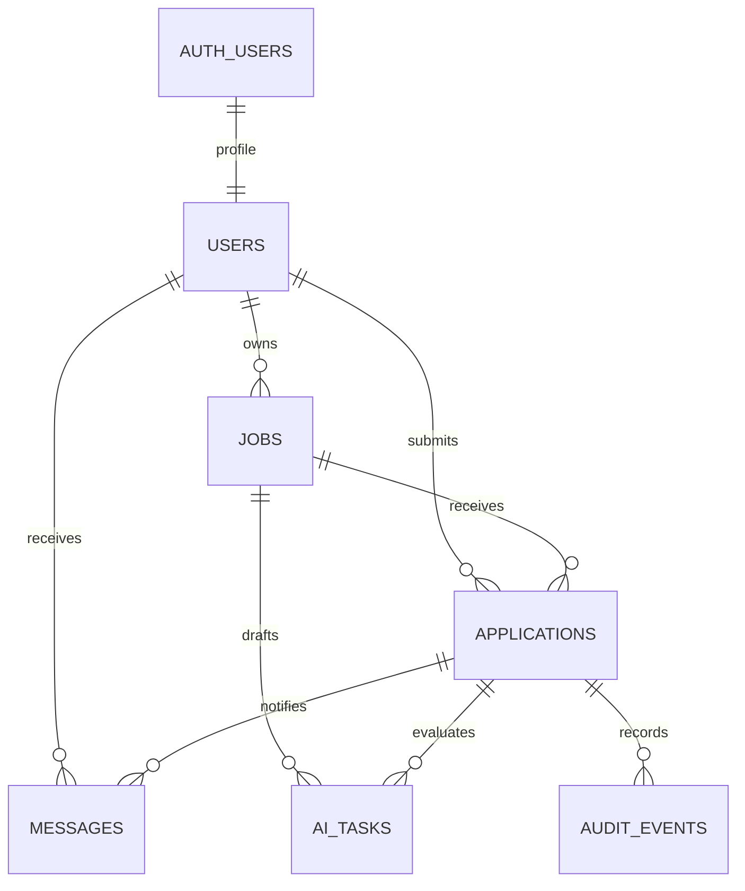

# 02 — Thiết kế cơ sở dữ liệu và hợp đồng JSON

Ngày lập: 02/11/2026. PostgreSQL trên Supabase; tên nghiệp vụ Users/Jobs/Applications/Messages được ánh xạ thành bảng `public.users`, `public.jobs`, `public.applications`, `public.messages`. Khóa UUID, timestamp `timestamptz` UTC, dữ liệu cấu trúc `jsonb`. Mọi cột mặc định NOT NULL trừ khi ghi rõ nullable.

## 1. Quan hệ



Giữ bốn bảng nghiệp vụ chính và bổ sung ba bảng hạ tầng `ai_tasks`, `idempotency_keys`, `audit_events`. Không nhét trạng thái queue hoặc log vào Messages. Bản đầu dùng chính bảng `ai_tasks` làm hàng đợi bền vững, không triển khai thêm Redis hoặc queue thứ hai.

## 2. Users

| Cột | Kiểu / mặc định | Ràng buộc và mục đích |
| --- | --- | --- |
| `id` | `uuid` | PK, FK `auth.users(id)`; một người dùng một hồ sơ |
| `display_name` | `varchar(120)` | Không rỗng sau trim |
| `preferred_mode` | `text default 'CANDIDATE'` | CHECK `HR`, `CANDIDATE`; không phải quyền bảo mật |
| `timezone` | `text default 'Asia/Bangkok'` | Kiểm tra tên timezone bằng allowlist IANA trên server |
| `created_at`, `updated_at` | `timestamptz default now()` | updated_at do trigger |
| `deletion_requested_at` | `timestamptz nullable` | Tiếp nhận yêu cầu xóa, chưa xóa ngay các FK |

Email và mật khẩu thuộc Supabase Auth, không sao chép password/hash vào bảng này. Tạo profile qua trigger hoặc quy trình server idempotent sau khi xác thực. Không có cột role HR/CANDIDATE loại trừ nhau.

## 3. Jobs

| Cột | Kiểu / mặc định | Ràng buộc và mục đích |
| --- | --- | --- |
| `id` | `uuid default gen_random_uuid()` | PK |
| `owner_user_id` | `uuid` | FK Users, index |
| `status` | `text default 'DRAFT'` | CHECK `DRAFT`, `PUBLISHED`, `CLOSED` |
| `version` | `integer default 1` | > 0; tăng với mỗi sửa nháp/đóng tin, dùng chống ghi đè |
| `raw_hr_prompt` | `text nullable` | Tối đa 8.000 ký tự; dữ liệu riêng HR |
| `jd_json` | `jsonb nullable` | JD cấu trúc; bắt buộc khi đăng |
| `title` | `varchar(180) nullable` | Bản chiếu tìm kiếm từ `jd_json.title` |
| `skills` | `text[] default '{}'` | Chuẩn hóa trim/lowercase/deduplicate cho lọc |
| `location` | `varchar(180) nullable` | Bản chiếu từ JD |
| `salary_min`, `salary_max` | `bigint nullable` | VND/tháng; >= 0, nếu có cả hai thì min <= max |
| `salary_currency` | `text default 'VND'` | Bản đầu chỉ VND |
| `salary_period` | `text default 'MONTH'` | Bản đầu chỉ MONTH |
| `scoring_rubric_json` | `jsonb nullable` | Schema §9; ngưỡng nằm ở đây, không có cột ngưỡng thứ hai |
| `interview_questions_json` | `jsonb nullable` | Schema §10; chứa đáp án/rubric riêng, không công khai |
| `interview_access_policy` | `text default 'CV_THRESHOLD'` | CHECK `CV_THRESHOLD`, `ALWAYS` |
| `approved_by_user_id` | `uuid nullable` | FK Users; khi đăng phải bằng owner_user_id |
| `published_at`, `closed_at` | `timestamptz nullable` | Theo trạng thái |
| `created_at`, `updated_at` | `timestamptz default now()` | Metadata |
| `search_vector` | `tsvector` | Generated từ title/summary/skills bằng cấu hình `simple` |

Nháp có thể chưa có đủ cấu trúc. Hàm publish yêu cầu đầy đủ JD/rubric/questions, kiểm tra tổng điểm, đồng bộ các cột tìm kiếm rồi mới chuyển PUBLISHED. Sau đăng, trigger khóa owner, JD, rubric, questions, chính sách thi và bản chiếu tìm kiếm; chỉ cho đóng tin. `simple` không giải quyết đầy đủ bỏ dấu tiếng Việt: bổ sung chuỗi tìm kiếm chuẩn hóa `unaccent` trong Phase 2, kiểm tra plan index trên dữ liệu thực.

Không hard-delete Jobs có Applications. FK dùng `ON DELETE RESTRICT`; đóng tin là hành động nghiệp vụ riêng.

## 4. Applications

| Cột | Kiểu / mặc định | Ràng buộc và mục đích |
| --- | --- | --- |
| `id` | `uuid default gen_random_uuid()` | PK |
| `job_id` | `uuid` | FK Jobs RESTRICT |
| `candidate_user_id` | `uuid` | FK Users RESTRICT |
| `status` | `text default 'CV_SUBMITTED'` | Enum nghiệp vụ ở tài liệu 01 |
| `version` | `integer default 1` | Optimistic concurrency cho thay đổi nghiệp vụ |
| `job_snapshot_json` | `jsonb` | Snapshot riêng gồm job_id, job_version, jd, rubric, câu hỏi/đáp án, chính sách; bất biến |
| `cv_source` | `text` | CHECK `PDF`, `DOCX`, `TEXT` |
| `cv_storage_path` | `text nullable` | Path bucket private; không lưu URL public |
| `cv_sha256` | `char(64)` | Hash text đã xác nhận; không dùng hash để nhận diện người |
| `cv_text` | `text` | 100–30.000 ký tự; đóng băng sau nộp |
| `ai_processing_acknowledged_at` | `timestamptz` | Thời điểm ứng viên xác nhận thông báo xử lý bằng AI |
| `cv_evaluation_json` | `jsonb nullable` | Schema §11; null khi chưa chấm thành công |
| `cv_score` | `smallint nullable` | 0–100; bản chiếu bằng total_score trong JSON |
| `interview_started_at`, `interview_deadline_at` | `timestamptz nullable` | Cùng null hoặc cùng có giá trị; deadline > started |
| `candidate_answers_json` | `jsonb default '{"quiz":[],"essay":[]}'` | Chỉ ID lựa chọn và text tự luận, cấu trúc §13 |
| `answer_version` | `integer default 0` | Tăng mỗi autosave, dùng compare-and-swap |
| `interview_submitted_at` | `timestamptz nullable` | Một lần duy nhất; sau đó khóa answers |
| `submission_reason` | `text nullable` | `MANUAL` hoặc `TIMEOUT` |
| `quiz_result_json` | `jsonb nullable` | Cùng cấu trúc `quiz` trong §12; lưu ngay lúc nộp |
| `interview_evaluation_json` | `jsonb nullable` | Schema §12; chỉ ghi khi có đủ kết quả |
| `interview_score` | `numeric(5,2) nullable` | 0–100, bằng total_score trong JSON |
| `hr_decision_message` | `text nullable` | 1–2.000 ký tự khi chốt |
| `hr_decided_by_user_id` | `uuid nullable` | FK Users, phải là chủ tin |
| `hr_decided_at` | `timestamptz nullable` | Có giá trị khi HR_APPROVED/HR_REJECTED |
| `created_at`, `updated_at` | `timestamptz default now()` | Theo dõi |

Ràng buộc: `UNIQUE(job_id,candidate_user_id)`; FK không cho thay job/candidate sau tạo. Chặn tự ứng tuyển bằng trigger truy vấn Jobs; không thể dùng CHECK thông thường để đọc bảng khác. `job_snapshot_json` do server đọc từ tin trong cùng transaction, không lấy snapshot do browser gửi.

Khi status từ CV_PASSED trở đi phải có cv_evaluation; với CV_FAILED cũng phải có cv_evaluation. EVALUATED/HR_APPROVED cần submitted_at và interview_evaluation. HR_REJECTED được phép không có interview_evaluation nếu đi từ CV_FAILED. Những điều kiện liên bảng và chuyển trạng thái được bảo vệ trong hàm transaction/trigger, không chỉ validator frontend.

## 5. Messages

| Cột | Kiểu / mặc định | Ràng buộc và mục đích |
| --- | --- | --- |
| `id` | `uuid default gen_random_uuid()` | PK |
| `recipient_user_id` | `uuid` | FK Users RESTRICT; chỉ người nhận được đọc |
| `actor_user_id` | `uuid nullable` | FK Users; null cho hệ thống, HR ID khi có quyết định |
| `application_id` | `uuid` | FK Applications RESTRICT |
| `kind` | `text` | Năm loại sự kiện ở tài liệu 01 |
| `event_key` | `varchar(240)` | UNIQUE; ví dụ `application:<uuid>:evaluated:<recipient_uuid>` |
| `subject` | `varchar(200)` | Tiêu đề văn bản thuần |
| `body` | `text` | Tối đa 5.000 ký tự; không chứa HTML hoặc đáp án |
| `payload_json` | `jsonb default '{}'` | Chỉ link nội bộ/điểm được phép/decision; allowlist, không sao chép snapshot |
| `read_at` | `timestamptz nullable` | Null là chưa đọc; chỉ chủ hộp thư được cập nhật |
| `created_at` | `timestamptz default now()` | Phân trang cursor `(created_at,id)` |

Thông báo giữ nội dung sự kiện tại thời điểm phát sinh. Quyền vào trang đích vẫn phải kiểm tra lại. Lời nhắn HR hiển thị bằng text escaping, không dùng innerHTML.

## 6. Bảng hạ tầng

### 6.1. AiTasks — queue bền vững

| Cột | Kiểu | Ý nghĩa |
| --- | --- | --- |
| `id` | uuid PK | ID trả frontend |
| `requested_by_user_id` | uuid FK Users | Người yêu cầu, dùng phân quyền xem task |
| `kind` | text | `GENERATE_JOB`, `EVALUATE_CV`, `EVALUATE_ESSAY` |
| `job_id`, `application_id` | uuid nullable FK | GENERATE_JOB chỉ job_id; hai loại còn lại chỉ application_id |
| `input_version` | integer | Phiên bản nháp/snapshot để chống kết quả cũ |
| `generation` | integer default 1 | Tăng khi retry thủ công sau thất bại |
| `state` | text default QUEUED | QUEUED/RUNNING/RETRY_WAIT/SUCCEEDED/FAILED |
| `network_attempts` | smallint default 0 | Số lần đã gửi provider; tối đa 3 cho mỗi generation, kể cả phục hồi worker |
| `available_at` | timestamptz default now() | Thời điểm đủ điều kiện claim/retry |
| `lease_owner` | uuid nullable | Worker hiện giữ task |
| `lease_until` | timestamptz nullable | Hết hạn lease; heartbeat mỗi 15 giây, TTL 90 giây |
| `error_code` | text nullable | Mã an toàn; không chứa body upstream |
| `model` | text | Model thực dùng |
| `prompt_version` | text | Ví dụ `recruitment-v1` |
| `created_at`, `updated_at`, `finished_at` | timestamptz | finished_at nullable |

Unique theo `(kind,job_id,input_version,generation)` với job_id không null và tương tự cho application_id. Chặn tạo hai generation đang hoạt động cho cùng kind/đối tượng bằng partial unique index trên các state chưa kết thúc. Input task lấy từ DB theo FK, không nhân bản toàn bộ CV/đáp án vào queue hoặc log.

Claim với `SELECT ... FOR UPDATE SKIP LOCKED`; cập nhật lease rồi commit, không giữ transaction khi gọi mạng. Trước mỗi HTTP attempt, transaction ngắn tăng network_attempts, xác nhận lease còn đúng. Commit kết quả dùng điều kiện lease_owner/input_version/state đúng; task cũ mất lease không được ghi kết quả. Heartbeat thất bại thì hủy HTTP bằng AbortSignal. Lỗi worker chết được tính vào budget đã đặt trước lần gọi; không tự bắt đầu lại ba lần mới vô hạn.

Kết quả và Messages ghi cùng transaction với task SUCCEEDED. Nếu tác vụ đã commit, lần giao lại chỉ trả kết quả cũ. Không bảo đảm chỉ một lần tính token ở Nine Router vì nhà cung cấp có thể đã nhận request trước khi kết nối đứt.

### 6.2. IdempotencyKeys

`user_id uuid FK`, `operation text`, `key varchar(128)`, `request_hash char(64)`, `resource_id uuid`, `response_status integer`, `created_at timestamptz`, `expires_at timestamptz`. PK `(user_id,operation,key)`; TTL đề xuất 24 giờ. Hash dùng payload đã chuẩn hóa. Khác payload với cùng key trả 409. Commit bản ghi cùng thao tác tạo tài nguyên, không cache response lỗi tạm thời hoặc CV vào bảng. Unique nghiệp vụ và trạng thái vẫn chống trùng sau khi key hết TTL.

### 6.3. AuditEvents

`id uuid PK`, `actor_user_id uuid nullable FK`, `job_id uuid nullable FK`, `application_id uuid nullable FK`, `event_type text`, `from_state text nullable`, `to_state text nullable`, `metadata_json jsonb`, `created_at timestamptz`. Server/worker chỉ append; ghi đổi trạng thái, publish/close, quyết định HR và retry thủ công. Metadata không chứa key, CV đầy đủ, prompt hoặc câu trả lời đầy đủ.

## 7. Index và ràng buộc triển khai

| Bảng | Index/ràng buộc |
| --- | --- |
| Jobs | `(owner_user_id,created_at DESC,id)`, partial `(published_at DESC,id) WHERE status='PUBLISHED'`, GIN skills, GIN search_vector |
| Applications | unique job/candidate; `(job_id,status,created_at DESC,id)`, `(candidate_user_id,created_at DESC,id)`; partial deadline WHERE status=INTERVIEW_IN_PROGRESS AND submitted_at IS NULL |
| Messages | `(recipient_user_id,created_at DESC,id)`, partial `(recipient_user_id) WHERE read_at IS NULL`; unique event_key |
| AiTasks | partial `(available_at,created_at,id)` cho QUEUED/RETRY_WAIT; `(lease_until)` cho RUNNING; unique và partial active index như §6 |
| IdempotencyKeys | PK tổng hợp và index expires_at |
| AuditEvents | `(application_id,created_at,id)`, `(job_id,created_at,id)` |

Migration cần có: enum/check, FK, index, trigger bất biến, kiểm tra chuyển trạng thái và chống self-apply, transaction functions cho publish/apply/start/save/submit/decision/complete-task, quyền EXECUTE giới hạn. Dùng tham số SQL, không nối chuỗi từ prompt. `SECURITY DEFINER` nếu cần phải có search_path cố định, schema-qualified tables, revoke EXECUTE khỏi public và tự kiểm tra actor.

### Bảng phụ Phase 3: CV tạm trước tiếp nhận

Migration 0004 thêm `public.cv_uploads`: `id uuid PK`, `owner_user_id uuid FK Users`, `source PDF|DOCX`, `storage_path text UNIQUE`, `state UPLOADED|PARSING|READY|FAILED`, `extracted_text nullable` tối đa 30.000 ký tự, `parse_token uuid nullable`, `parse_started_at nullable`, `used_at nullable`, `created_at`, `expires_at` mặc định 24 giờ. RLS bật, không grant browser; chỉ server thao tác. Path ngẫu nhiên dưới UUID owner do server cấp. Token parser chống hai kết quả ghi đè; file READY không parse lại, file đã dùng hoặc hết TTL không thể nộp. Rate limit 10 upload/giờ/owner tính trong transaction. TTL hiện là giới hạn quyền sử dụng; purge object thuộc Phase 5.

`cv_sha256` của Applications tiếp tục là SHA-256 text đã xác nhận (không phải hash binary). File cần text khớp kết quả server trích xuất; muốn sửa thì chuyển sang nguồn TEXT. Snapshot chỉ do trigger dựng từ Jobs dưới row lock. CV completion tính tổng, ngưỡng và passed lại trên server/SQL, ghi kết quả và Messages trong cùng transaction. Retry CV tối đa hai generation thủ công/24 giờ/hồ sơ, không reset budget của task cũ.

## 8. Phân quyền và dữ liệu công khai

Chọn mô hình backend làm cổng truy cập duy nhất cho dữ liệu nghiệp vụ. Không cấp SELECT/INSERT/UPDATE/DELETE trực tiếp cho anon/authenticated trên Jobs/Applications/AiTasks có JSON riêng. Bật RLS để mặc định từ chối; frontend dùng Supabase Auth cho danh tính, còn đọc/ghi nghiệp vụ qua API. Backend dùng khóa server riêng và phải kiểm tra session/ownership trên từng thao tác vì service role có thể bypass RLS. RLS không che được một cột JSON nếu vẫn cho SELECT hàng đó. [Tài liệu RLS của Supabase](https://supabase.com/docs/guides/database/postgres/row-level-security).

| Đối tượng | Quyền qua API |
| --- | --- |
| Khách | GET tin đã PUBLISHED, DTO công khai theo allowlist |
| Người đăng nhập | Sửa profile của mình, tạo tin nháp, tìm việc, nộp CV vào tin người khác |
| Chủ tin | CRUD nháp của mình, publish/close, xem hồ sơ gửi vào tin, xem rubric/đáp án, quyết định |
| Chủ hồ sơ | Xem tiến trình/kết quả đã lược thông tin riêng, lấy đề khi được phép bắt đầu, lưu/nộp câu trả lời |
| Người nhận Message | Xem và đánh dấu đọc thông báo của mình |
| Worker | Claim task, đọc input cần thiết, ghi kết quả có điều kiện; không endpoint công khai |

DTO công khai của Jobs chỉ có id, title, jd công khai, skills, location, salary, published_at, duration_minutes và chính sách mở khóa. Không trả `raw_hr_prompt`, `scoring_rubric_json` chi tiết, `interview_questions_json`, ai_tasks hay snapshot. Tuyệt đối không `SELECT *` rồi spread vào JSON response.

DTO đề thi chỉ tạo sau start: quiz `{id,prompt,options:[{id,text}]}`; essay `{id,prompt}`; thêm deadline_at/server_now/answer_version. Không có `correct_answer`, rubric, scoring_guidance, expected_answer hoặc metadata riêng, kể cả trong Server Component props, HTML và cache. API kết quả ứng viên chỉ trả điểm/tóm tắt; API HR riêng mới có chi tiết chấm. Dùng `Cache-Control: private, no-store` cho các response riêng tư.

Bucket CV là private; upload path cấp từ server theo user/application random UUID, kiểm tra quyền và kích thước; link tải thời hạn ngắn, ví dụ 60 giây, chỉ cấp cho ứng viên/chủ tin. Chỉ trích text bằng server và không lưu CV trong public assets. [Storage access control](https://supabase.com/docs/guides/storage/security/access-control).

## 9. Schema: Jobs.scoring_rubric_json

JSON Schema Draft 2020-12, không cho khóa ngoài hợp đồng. `max_points` là số điểm tối đa của tiêu chí và cũng là trọng số, tổng phải bằng 100. Ngưỡng là số nguyên 0–100.

```json
{
  "$schema": "https://json-schema.org/draft/2020-12/schema",
  "title": "ScoringRubric",
  "type": "object",
  "additionalProperties": false,
  "required": ["schema_version", "pass_threshold", "criteria"],
  "properties": {
    "schema_version": {"const": 1},
    "pass_threshold": {"type": "integer", "minimum": 0, "maximum": 100},
    "criteria": {
      "type": "array", "minItems": 1, "maxItems": 20,
      "items": {
        "type": "object", "additionalProperties": false,
        "required": ["id", "label", "max_points", "scoring_guidance"],
        "properties": {
          "id": {"type": "string", "pattern": "^[a-z][a-z0-9_]{0,63}$"},
          "label": {"type": "string", "minLength": 1, "maxLength": 200},
          "max_points": {"type": "integer", "minimum": 1, "maximum": 100},
          "scoring_guidance": {"type": "string", "minLength": 1, "maxLength": 4000}
        }
      }
    }
  }
}
```

Ví dụ hợp lệ:

```json
{
  "schema_version": 1,
  "pass_threshold": 60,
  "criteria": [
    {"id": "typescript", "label": "TypeScript thực tế", "max_points": 60, "scoring_guidance": "0: không có bằng chứng; 30: có dự án sử dụng; 60: có dự án và mô tả trách nhiệm TypeScript rõ ràng."},
    {"id": "testing", "label": "Kiểm thử phần mềm", "max_points": 40, "scoring_guidance": "0: không có bằng chứng; 20: nêu được công cụ; 40: mô tả đã viết test và phạm vi kiểm thử."}
  ]
}
```

Validator nghiệp vụ bổ sung: ID tiêu chí duy nhất, tổng max_points = 100, label/scoring_guidance không toàn khoảng trắng. JSON Schema tiêu chuẩn không tự kiểm tra tổng các phần tử hoặc uniqueness theo thuộc tính id.

## 10. Schema: Jobs.interview_questions_json

Mỗi tin có ít nhất một câu mỗi loại; nhiều nhất 30 quiz và 10 essay. `max_points` là điểm thô từng câu, sau đó chuẩn hóa mỗi phần về 100. Bản đầu cố định tỷ trọng 40/60 để tránh thêm biến cấu hình.

```json
{
  "$schema": "https://json-schema.org/draft/2020-12/schema",
  "title": "InterviewQuestions",
  "type": "object", "additionalProperties": false,
  "required": ["schema_version", "duration_minutes", "quiz_weight", "essay_weight", "quiz", "essay"],
  "properties": {
    "schema_version": {"const": 1},
    "duration_minutes": {"type": "integer", "minimum": 5, "maximum": 120},
    "quiz_weight": {"const": 40},
    "essay_weight": {"const": 60},
    "quiz": {"type": "array", "minItems": 1, "maxItems": 30, "items": {"$ref": "#/$defs/quizQuestion"}},
    "essay": {"type": "array", "minItems": 1, "maxItems": 10, "items": {"$ref": "#/$defs/essayQuestion"}}
  },
  "$defs": {
    "id": {"type": "string", "pattern": "^[a-z][a-z0-9_]{0,63}$"},
    "longText": {"type": "string", "minLength": 1, "maxLength": 4000},
    "points": {"type": "integer", "minimum": 1, "maximum": 100},
    "quizQuestion": {
      "type": "object", "additionalProperties": false,
      "required": ["id", "prompt", "options", "correct_answer", "max_points"],
      "properties": {
        "id": {"$ref": "#/$defs/id"},
        "prompt": {"$ref": "#/$defs/longText"},
        "options": {
          "type": "array", "minItems": 2, "maxItems": 6,
          "items": {
            "type": "object", "additionalProperties": false,
            "required": ["id", "text"],
            "properties": {"id": {"$ref": "#/$defs/id"}, "text": {"$ref": "#/$defs/longText"}}
          }
        },
        "correct_answer": {"$ref": "#/$defs/id"},
        "max_points": {"$ref": "#/$defs/points"}
      }
    },
    "essayQuestion": {
      "type": "object", "additionalProperties": false,
      "required": ["id", "prompt", "max_points", "rubric"],
      "properties": {
        "id": {"$ref": "#/$defs/id"},
        "prompt": {"$ref": "#/$defs/longText"},
        "max_points": {"$ref": "#/$defs/points"},
        "rubric": {
          "type": "array", "minItems": 1, "maxItems": 10,
          "items": {
            "type": "object", "additionalProperties": false,
            "required": ["id", "description", "max_points", "scoring_guidance"],
            "properties": {
              "id": {"$ref": "#/$defs/id"},
              "description": {"$ref": "#/$defs/longText"},
              "max_points": {"$ref": "#/$defs/points"},
              "scoring_guidance": {"$ref": "#/$defs/longText"}
            }
          }
        }
      }
    }
  }
}
```

Ví dụ đầy đủ:

```json
{
  "schema_version": 1,
  "duration_minutes": 30,
  "quiz_weight": 40,
  "essay_weight": 60,
  "quiz": [
    {
      "id": "q_type",
      "prompt": "TypeScript kiểm tra kiểu chủ yếu ở giai đoạn nào?",
      "options": [{"id": "a", "text": "Trước khi chạy khi kiểm tra/biên dịch"}, {"id": "b", "text": "Tự động kiểm tra mọi giá trị API lúc runtime"}],
      "correct_answer": "a",
      "max_points": 10
    }
  ],
  "essay": [
    {
      "id": "e_api",
      "prompt": "Bạn xử lý dữ liệu JSON từ API bên ngoài như thế nào?",
      "max_points": 10,
      "rubric": [
        {"id": "validation", "description": "Kiểm tra dữ liệu runtime", "max_points": 6, "scoring_guidance": "0: không kiểm tra; 3: chỉ kiểm tra một số field; 6: kiểm tra schema trước sử dụng."},
        {"id": "errors", "description": "Xử lý lỗi an toàn", "max_points": 4, "scoring_guidance": "0: bỏ qua lỗi; 2: có bắt lỗi; 4: bắt lỗi và phản hồi an toàn, không lộ dữ liệu riêng."}
      ]
    }
  ]
}
```

Ràng buộc thêm: ID câu hỏi duy nhất xuyên cả hai phần; ID lựa chọn duy nhất trong câu; correct_answer thuộc options; ID tiêu chí essay duy nhất trong câu; tổng max_points rubric essay bằng max_points câu đó. Những trường này chỉ nằm trong dữ liệu server/HR, DTO ứng viên phải dựng bằng allowlist theo §8.

## 11. Schema: Applications.cv_evaluation_json

Đây là kết quả đã được server chuẩn hóa, không lưu nguyên văn response AI. AI chỉ trả từng tiêu chí và summary; server gắn max_points, cộng tổng, đọc ngưỡng snapshot và tính passed.

```json
{
  "$schema": "https://json-schema.org/draft/2020-12/schema",
  "title": "CvEvaluation",
  "type": "object", "additionalProperties": false,
  "required": ["schema_version", "criteria", "total_score", "pass_threshold", "passed", "summary"],
  "properties": {
    "schema_version": {"const": 1},
    "criteria": {
      "type": "array", "minItems": 1, "maxItems": 20,
      "items": {
        "type": "object", "additionalProperties": false,
        "required": ["criterion_id", "score", "max_points", "evidence", "missing_evidence", "feedback"],
        "properties": {
          "criterion_id": {"type": "string", "pattern": "^[a-z][a-z0-9_]{0,63}$"},
          "score": {"type": "integer", "minimum": 0, "maximum": 100},
          "max_points": {"type": "integer", "minimum": 1, "maximum": 100},
          "evidence": {"type": "array", "maxItems": 10, "items": {"type": "string", "minLength": 1, "maxLength": 2000}},
          "missing_evidence": {"type": "array", "maxItems": 10, "items": {"type": "string", "minLength": 1, "maxLength": 2000}},
          "feedback": {"type": "string", "minLength": 1, "maxLength": 2000}
        }
      }
    },
    "total_score": {"type": "integer", "minimum": 0, "maximum": 100},
    "pass_threshold": {"type": "integer", "minimum": 0, "maximum": 100},
    "passed": {"type": "boolean"},
    "summary": {"type": "string", "minLength": 1, "maxLength": 2000}
  }
}
```

Ví dụ ứng với rubric §9:

```json
{
  "schema_version": 1,
  "criteria": [
    {"criterion_id": "typescript", "score": 60, "max_points": 60, "evidence": ["Phát triển API bằng TypeScript, phụ trách kiểm tra dữ liệu đầu vào."], "missing_evidence": [], "feedback": "Có dự án và trách nhiệm cụ thể."},
    {"criterion_id": "testing", "score": 20, "max_points": 40, "evidence": ["Công cụ: Vitest."], "missing_evidence": ["Chưa mô tả phạm vi test đã viết."], "feedback": "Mới có bằng chứng về tên công cụ."}
  ],
  "total_score": 80,
  "pass_threshold": 60,
  "passed": true,
  "summary": "Có bằng chứng TypeScript; nên xác minh thêm kinh nghiệm viết test."
}
```

Server xác nhận mỗi criterion_id xuất hiện đúng một lần và khớp snapshot; `0 <= score <= max_points`; mọi evidence là đoạn có thật trong CV; điểm dương cần ít nhất một bằng chứng. Không có bằng chứng thì cho 0 và ghi rõ chưa đủ thông tin, không suy diễn ứng viên không có kỹ năng. `total_score = sum(score)` và `passed = total_score >= pass_threshold`.

## 12. Schema: Applications.interview_evaluation_json

Điểm thô có thể lớn hơn 100 khi nhiều câu. `score` từng phần và total_score là 0–100. Backend chấm quiz, AI chỉ chấm tiêu chí essay; backend tạo cấu trúc cuối cùng.

```json
{
  "$schema": "https://json-schema.org/draft/2020-12/schema",
  "title": "InterviewEvaluation",
  "type": "object", "additionalProperties": false,
  "required": ["schema_version", "quiz", "essay", "quiz_weight", "essay_weight", "total_score"],
  "properties": {
    "schema_version": {"const": 1},
    "quiz": {"$ref": "#/$defs/quizResult"},
    "essay": {"$ref": "#/$defs/essayResult"},
    "quiz_weight": {"const": 40},
    "essay_weight": {"const": 60},
    "total_score": {"$ref": "#/$defs/normalizedScore"}
  },
  "$defs": {
    "id": {"type": "string", "pattern": "^[a-z][a-z0-9_]{0,63}$"},
    "text": {"type": "string", "minLength": 1, "maxLength": 2000},
    "rawPoints": {"type": "integer", "minimum": 0, "maximum": 3000},
    "maxPoints": {"type": "integer", "minimum": 1, "maximum": 3000},
    "normalizedScore": {"type": "number", "minimum": 0, "maximum": 100},
    "quizResult": {
      "type": "object", "additionalProperties": false,
      "required": ["earned_points", "max_points", "score", "questions"],
      "properties": {
        "earned_points": {"$ref": "#/$defs/rawPoints"},
        "max_points": {"$ref": "#/$defs/maxPoints"},
        "score": {"$ref": "#/$defs/normalizedScore"},
        "questions": {
          "type": "array", "minItems": 1, "maxItems": 30,
          "items": {
            "type": "object", "additionalProperties": false,
            "required": ["question_id", "selected_answer", "is_correct", "earned_points", "max_points"],
            "properties": {
              "question_id": {"$ref": "#/$defs/id"},
              "selected_answer": {"anyOf": [{"$ref": "#/$defs/id"}, {"type": "null"}]},
              "is_correct": {"type": "boolean"},
              "earned_points": {"type": "integer", "minimum": 0, "maximum": 100},
              "max_points": {"type": "integer", "minimum": 1, "maximum": 100}
            }
          }
        }
      }
    },
    "essayResult": {
      "type": "object", "additionalProperties": false,
      "required": ["earned_points", "max_points", "score", "questions", "summary"],
      "properties": {
        "earned_points": {"$ref": "#/$defs/rawPoints"},
        "max_points": {"$ref": "#/$defs/maxPoints"},
        "score": {"$ref": "#/$defs/normalizedScore"},
        "summary": {"$ref": "#/$defs/text"},
        "questions": {
          "type": "array", "minItems": 1, "maxItems": 10,
          "items": {
            "type": "object", "additionalProperties": false,
            "required": ["question_id", "earned_points", "max_points", "criteria", "feedback"],
            "properties": {
              "question_id": {"$ref": "#/$defs/id"},
              "earned_points": {"type": "integer", "minimum": 0, "maximum": 100},
              "max_points": {"type": "integer", "minimum": 1, "maximum": 100},
              "feedback": {"$ref": "#/$defs/text"},
              "criteria": {
                "type": "array", "minItems": 1, "maxItems": 10,
                "items": {
                  "type": "object", "additionalProperties": false,
                  "required": ["criterion_id", "score", "max_points", "evidence", "feedback"],
                  "properties": {
                    "criterion_id": {"$ref": "#/$defs/id"},
                    "score": {"type": "integer", "minimum": 0, "maximum": 100},
                    "max_points": {"type": "integer", "minimum": 1, "maximum": 100},
                    "evidence": {"type": "array", "maxItems": 10, "items": {"$ref": "#/$defs/text"}},
                    "feedback": {"$ref": "#/$defs/text"}
                  }
                }
              }
            }
          }
        }
      }
    }
  }
}
```

Ví dụ ứng với bộ câu hỏi §10:

```json
{
  "schema_version": 1,
  "quiz": {
    "earned_points": 10, "max_points": 10, "score": 100,
    "questions": [{"question_id": "q_type", "selected_answer": "a", "is_correct": true, "earned_points": 10, "max_points": 10}]
  },
  "essay": {
    "earned_points": 8, "max_points": 10, "score": 80,
    "questions": [
      {
        "question_id": "e_api", "earned_points": 8, "max_points": 10,
        "criteria": [
          {"criterion_id": "validation", "score": 6, "max_points": 6, "evidence": ["Tôi kiểm tra schema trước khi dùng dữ liệu."], "feedback": "Nêu rõ kiểm tra runtime."},
          {"criterion_id": "errors", "score": 2, "max_points": 4, "evidence": ["Tôi bắt lỗi và hiển thị thông báo."], "feedback": "Chưa nói rõ việc che dữ liệu riêng."}
        ],
        "feedback": "Có kiểm tra dữ liệu, cần làm rõ xử lý lỗi an toàn."
      }
    ],
    "summary": "Đáp ứng phần kiểm tra dữ liệu; xử lý lỗi cần chi tiết hơn."
  },
  "quiz_weight": 40,
  "essay_weight": 60,
  "total_score": 88
}
```

Quy tắc server: chấm quiz bằng ID lựa chọn, bỏ trống là null và 0 điểm; không tin điểm/is_correct do client gửi. Essay kiểm tra đủ câu/tiêu chí, không trùng ID, score không vượt max, evidence trích đúng câu trả lời của câu đó. Điểm dương cần evidence; câu trắng mọi tiêu chí bằng 0. Tính:

```text
quiz.score = round2(100 * sum(quiz.earned_points) / sum(quiz.max_points))
essay.score = round2(100 * sum(essay.earned_points) / sum(essay.max_points))
total_score = round2(quiz.score * 0.4 + essay.score * 0.6)
round2(x) = Math.round((x + Number.EPSILON) * 100) / 100
```

Tổng dùng điểm phần đã round2 để UI và backend khớp nhau. Lưu null cho toàn bộ interview_evaluation nếu essay lỗi, không thay null bằng 0. `quiz_result_json` vẫn giữ được để không cần chấm lại.

### Giao dịch bài thi Phase 4

Migration 0005 thêm RPC start/GET DTO/save/prepare/submit/due/essay completion/retry. Không thêm bảng hoặc sửa snapshot đã có. Mọi RPC chỉ service_role được EXECUTE. Browser chỉ đi qua API đã xác thực; DTO trước start không có câu hỏi, DTO trong bài chỉ có prompt/options, DTO sau nộp không phát lại đề/câu trả lời riêng.

`answer_version` chỉ tăng khi autosave thành công; submit lấy bản đã lưu, `gradeQuiz` local và khóa bằng row lock + kiểm tra source version. Transaction đóng bài ghi cùng lúc submitted_at/reason, quiz_result_json, task EVALUATE_ESSAY với input_version=answer_version+1, Message và audit. Submit gọi lặp trả bài đã nộp; không reset timer hoặc tạo task thứ hai. Deadline dùng clock_timestamp tại server; sweep 15 giây gọi cùng cơ chế nộp bài.

Essay completion xác minh lease, snapshot, bản quiz đã giữ, ID/điểm/bằng chứng từ đúng câu trả lời, tổng điểm phần và 40/60 trước khi ghi EVALUATED/Messages. Quiz và CV giữ riêng. Retry chỉ FAILED/latest, hai generation thủ công/24 giờ/hồ sơ/loại, không đổi answers/deadline. API HR có bản chiếu đề/đáp án/câu trả lời/bằng chứng cần thiết; API ứng viên chỉ có điểm phần/tổng/tóm tắt. Không có trường riêng nào được spread từ snapshot vào DTO ứng viên.

## 13. JSON phụ và tính tương thích

JD trong Jobs và output generate dùng đúng cấu trúc sau; salary null biểu thị thỏa thuận, giá trị chưa biết không được AI tự bịa:

```json
{
  "title": "Lập trình viên TypeScript",
  "summary": "Phát triển API và kiểm thử cho sản phẩm web.",
  "responsibilities": ["Xây dựng API", "Viết kiểm thử"],
  "requirements": ["Có bằng chứng sử dụng TypeScript"],
  "benefits": ["Trao đổi khi phỏng vấn"],
  "skills": ["TypeScript", "Testing"],
  "location": "Trao đổi khi phỏng vấn",
  "salary_min": null,
  "salary_max": null,
  "salary_currency": "VND",
  "salary_period": "MONTH"
}
```

CandidateAnswers, ví dụ đầy đủ:

```json
{
  "quiz": [{"question_id": "q_type", "selected_answer": "a"}],
  "essay": [{"question_id": "e_api", "text": "Tôi kiểm tra schema trước khi dùng dữ liệu. Tôi bắt lỗi và hiển thị thông báo."}]
}
```

Client có thể gửi thiếu câu; server chuẩn hóa theo toàn bộ snapshot thành null hoặc text rỗng khi nộp. Từ chối ID không thuộc đề, lựa chọn sai ID, ID trùng, text essay quá 5.000 ký tự/câu và body quá 100 KiB. Schema strict không nhận thêm score, correct_answer, rubric hoặc deadline do client đặt.

Mọi JSON đã lưu có schema_version = 1. Đổi schema cần migration và parser đọc phiên bản cũ; không sửa ngầm snapshot. Lưu provenance model/prompt_version/task trong AiTasks và AuditEvents, không gắn trường mới vào JSON strict mà không nâng phiên bản.

## 14. Lưu giữ dữ liệu, xóa và sao lưu

Mặc định đề xuất: file tạm chưa nộp xóa trong 24 giờ; CV/answers/evaluations lưu tối đa 180 ngày sau quyết định HR hoặc sau ngày tạo nếu hồ sơ chưa được quyết định; log kỹ thuật không chứa PII giữ 30 ngày. Chính sách phải được chủ sản phẩm chốt trước production và công khai cho người dùng, không coi đây là khẳng định pháp lý.

Tác vụ purge phải tạm khóa hồ sơ, kiểm tra task đang chạy, xóa đối tượng Storage, xóa Messages/AuditEvents theo chính sách rồi Applications và dữ liệu cá nhân liên quan trong thứ tự FK; không bật cascade làm mất dữ liệu ngoài ý muốn. Yêu cầu xóa tài khoản đóng tin và đi qua cùng quy trình. UUID/hash/điểm cũng có thể liên kết lại người dùng, không tự coi là ẩn danh. Thiết lập backup và diễn tập khôi phục, lưu ý thời gian lưu backup có thể khác dữ liệu hoạt động.

### Giao dịch hoàn tất Phase 5

Migration 0006 thêm `purge_pending_at` vào Applications/CvUploads và các RPC chỉ dành cho service_role:

- `lc_decide_application`: khóa hồ sơ theo chủ tin, kiểm tra expected version, lời nhắn 1–2.000 ký tự và chuyển EVALUATED thành HR_APPROVED/HR_REJECTED; CV_FAILED chưa bắt đầu được REJECT. Ghi quyết định/thư/audit cùng transaction. Retry đúng quyết định/nội dung trả kết quả đã chốt; yêu cầu khác sau quyết định trả conflict, không thêm thư.
- `lc_inbox`, `lc_message`: keyset `(created_at,id)`, limit 1–50, unread count riêng người nhận, `read_at=coalesce(read_at,clock_timestamp())`; DTO allowlist không chứa payload hoặc snapshot riêng tư.
- `lc_hr_summary`: số hồ sơ của chủ tin, có thể lọc một tin do người đó sở hữu.
- `lc_deletion_request`: ghi thời điểm idempotent, đóng tin PUBLISHED ngay; cho hủy trong 7 ngày. Hết thời gian hủy, worker xử lý theo policy. Không mở lại tin khi hủy.
- `lc_claim_purge`: batch giới hạn, khóa và đánh dấu hồ sơ/upload trước khi xóa Storage, bỏ qua task có lease RUNNING/RETRY_WAIT còn hiệu lực. Trigger chặn sửa dữ liệu đang purge hoặc tạo task mới. `lc_finish_purge` xóa theo thứ tự FK sau khi file đã xóa; `lc_deletion_candidates` chuẩn bị Auth deletion. Hai hàm xóa là SECURITY DEFINER với search_path rỗng và không có quyền EXECUTE của public/anon/authenticated. Quyền DELETE audit trực tiếp của service_role vẫn bị thu hồi.
- `lc_operations`: thống kê tổng hợp nội bộ, không phát ra browser; web health chỉ trả ready/unavailable.

API mới: `POST /api/hr/applications/:id/decision` nhận `{expected_version,decision:APPROVE|REJECT,message}`; `GET /api/inbox` nhận limit/cursor/unread; `GET /api/inbox/:id`, `POST /api/inbox/:id` đánh dấu đã đọc; `GET|POST /api/me/deletion-request`, POST nhận `{requested:boolean}`. Tất cả kiểm tra session; mutation kiểm tra Origin. Application detail có version, lời nhắn và thời điểm HR quyết định.

Chính sách 180 ngày và grace 7 ngày là mặc định local. `DATA_RETENTION_ENABLED=false` tạm ngừng purge hồ sơ/tài khoản, vẫn dọn upload tạm và key idempotency hết hạn; Settings thể hiện trạng thái chưa kích hoạt. Xem `docs/OPERATIONS.md` để chốt policy, bật worker, backup và nghiệm thu staging trước production.

Các migration 0001–0006 đã được kiểm thử local; trạng thái Supabase hosted được kiểm tra riêng bằng `npm run phase5:check`.
