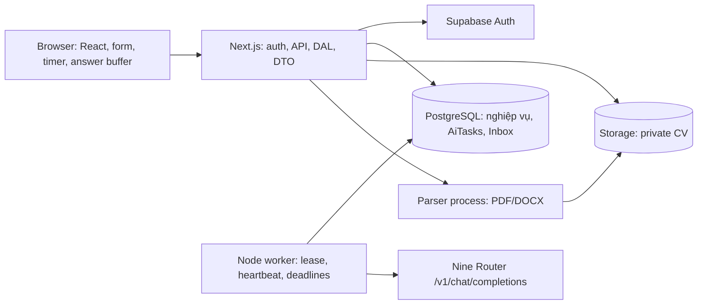

# 04 — Kiến trúc và kế hoạch triển khai năm giai đoạn

Ngày lập: 02/11/2026. Đây là kế hoạch cho các lượt lập trình sau. Phạm vi lượt hiện tại chỉ tạo bốn tài liệu trong `docs/`, chưa scaffold ứng dụng, chưa tạo môi trường thật, chưa deploy.

## 1. Tech stack đề xuất

Chọn một repository TypeScript, một ứng dụng Next.js và một worker Node.js; dùng PostgreSQL cho dữ liệu và hàng đợi để giảm số dịch vụ cần vận hành. Giữ SQL migrations và hợp đồng JSON rõ ràng để mỗi lượt AI code có phạm vi nhỏ và kiểm chứng được.

| Lớp | Lựa chọn | Lý do / giới hạn |
| --- | --- | --- |
| Web/API | Next.js App Router, React, TypeScript strict, Node runtime | UI và API cùng kiểu dữ liệu; Server Components cho đọc, Route Handlers cho nghiệp vụ; endpoint nào cũng xác thực/phân quyền |
| UI | Tailwind CSS, shadcn/ui, React Hook Form + Zod | Form sửa rubric/câu hỏi có validation, component dễ tùy biến; dùng token và thành phần chung |
| Auth | Supabase Auth và `@supabase/ssr` | Một định danh cho hai chế độ; xác thực session trên server, không tin user_id trong body |
| Data | Supabase PostgreSQL, SQL migrations, generated DB types | JSONB phù hợp đề thi/báo cáo; transaction và khóa hàng cho submit/decision; chưa thêm ORM |
| Truy cập DB | Supabase server client; RPC transaction functions | Một yêu cầu nghiệp vụ phức hợp là một transaction DB, không nhiều lời gọi REST rời |
| Files | Supabase Storage private | Chỉ người có quyền tải CV qua signed URL ngắn hạn |
| Extraction | PDF.js (`pdfjs-dist`) và Mammoth `extractRawText` | Trích text trên server, không render HTML, chưa OCR; bọc parser trong process/budget riêng |
| AI | Native fetch → Nine Router | Kiểm soát chính xác timeout 60s, hai retry, giới hạn body; module trong tài liệu 03 |
| Queue | Bảng `ai_tasks`, worker Node.js | Claim/lease/heartbeat bền vững; không cần Redis; xử lý ít đến vừa, mở rộng worker sau đo tải |
| Tiến trình UI | Poll API mỗi 2–5 giây, backoff khi tab ẩn | Dễ khôi phục và kiểm thử; realtime không bắt buộc |
| Testing | Vitest, Playwright, PostgreSQL test riêng | Unit cho JSON/điểm/timer, integration cho transaction/quyền, end-to-end cho hai người dùng |
| CI | Lint, typecheck, unit, integration, build, end-to-end | Không dùng key Nine Router thật trong CI |
| Hosting | Web Node và worker luôn chạy, cùng vùng với DB | Worker không phụ thuộc giới hạn request; Storage không lưu trên ổ cục bộ web |

Tại Phase 1 chọn các bản stable tương thích Node LTS và ghi phiên bản chính xác vào package.json/lockfile; dùng `npm ci` trong CI. Không lấy hướng dẫn cấu hình từ phiên bản cũ hoặc mặc định rằng mọi gói “latest” tương thích nhau. Không cần microservices, vector database hoặc framework agent cho phạm vi hiện tại.

Nguồn chính thức cho các lựa chọn: [Next.js installation](https://nextjs.org/docs/app/getting-started/installation), [Supabase SSR](https://supabase.com/docs/guides/auth/server-side/nextjs), [Tailwind với Next.js](https://tailwindcss.com/docs/installation/framework-guides/nextjs), [shadcn/ui với Next.js](https://ui.shadcn.com/docs/installation/next), [PDF.js](https://github.com/mozilla/pdf.js), [Mammoth](https://github.com/mwilliamson/mammoth.js), [Vitest](https://vitest.dev/guide/), [Playwright](https://playwright.dev/docs/intro).

## 2. Kiến trúc chạy thực tế



Chỉ server/worker có Nine Router key và Supabase server secret. Browser chỉ có cấu hình Auth công khai. Không coi route đổi chế độ là cơ chế cấp quyền.

API trả `202` cho AI; không giữ kết nối vài phút chờ model. Worker đọc job/snapshot từ DB theo task ID, chạy module 03 và commit kết quả có điều kiện. Tác vụ hết giờ thi được sweep mỗi 15 giây và dùng chung transaction submit với ứng viên. Worker cần readiness/liveness và shutdown có kiểm soát, ngừng claim trước khi tắt, hủy request khi mất lease.

Parser tài liệu là tác vụ riêng chạy trong tiến trình bị giới hạn tài nguyên, không đặt chung với luồng render. Luồng trích xuất MVP dùng worker process trên máy chủ và API có budget ngắn; nếu trích xuất chưa xong trong budget, trả trạng thái công việc trích xuất qua reference tạm. Không biến CV chưa trích được thành một hồ sơ bị đánh trượt. Để tránh mở rộng enum AiTasks không cần thiết, có thể triển khai extract request đồng bộ với budget tối đa 10 giây và trả lỗi hướng dẫn đổi file/dán text khi vượt budget; đây là lựa chọn mặc định bản đầu.

Queue chỉ claim hàng tới hạn và chưa có lease hợp lệ: QUEUED/RETRY_WAIT không lease hoặc lease đã hết, hoặc RUNNING hết lease. Backoff của worker còn giữ lease không được consumer khác lấy. Mỗi HTTP attempt ghi budget trước khi gửi; kết quả chỉ được commit bởi lease_owner hiện hành. Nếu task hết budget thì FAILED có kiểm soát. Giới hạn mặc định hai tác vụ AI song song/worker, một task active/đối tượng/loại; tăng theo quota gateway và số liệu quan sát.

Supabase cũng có queue PostgreSQL dùng pgmq, phù hợp nếu sau này cần công cụ quản trị queue chuyên biệt. Bản đầu không dùng đồng thời pgmq và `ai_tasks` làm hai nguồn sự thật. [Supabase Queues](https://supabase.com/docs/guides/queues).

Nếu đặt web trên môi trường serverless, vẫn giữ worker riêng; kiểm tra timeout thật của hosting, proxy và kết nối DB. Không chỉ tăng timeout API route rồi giả định cold start và retry đều nằm gọn trong một request. Không có thao tác triển khai hoặc tạo dịch vụ nào được thực hiện ở bộ tài liệu này.

## 3. Cây thư mục mục tiêu

```text
AppLocCV/
├─ docs/
│  ├─ 01_PRD_AND_USER_FLOW.md
│  ├─ 02_DATABASE_SCHEMA.md
│  ├─ 03_AI_SERVICE_AND_PROMPTS.md
│  └─ 04_IMPLEMENTATION_PLAN.md
├─ src/
│  ├─ app/
│  │  ├─ (auth)/login/page.tsx
│  │  ├─ (auth)/signup/page.tsx
│  │  ├─ (auth)/forgot-password/page.tsx
│  │  ├─ auth/callback/route.ts
│  │  ├─ (platform)/layout.tsx
│  │  ├─ (platform)/jobs/page.tsx
│  │  ├─ (platform)/jobs/[jobId]/page.tsx
│  │  ├─ (platform)/jobs/[jobId]/apply/page.tsx
│  │  ├─ (platform)/hr/page.tsx
│  │  ├─ (platform)/hr/jobs/new/page.tsx
│  │  ├─ (platform)/hr/jobs/[jobId]/page.tsx
│  │  ├─ (platform)/hr/jobs/[jobId]/edit/page.tsx
│  │  ├─ (platform)/hr/applications/[id]/page.tsx
│  │  ├─ (platform)/candidate/applications/page.tsx
│  │  ├─ (platform)/candidate/applications/[id]/page.tsx
│  │  ├─ (platform)/candidate/applications/[id]/interview/page.tsx
│  │  ├─ (platform)/inbox/page.tsx
│  │  ├─ (platform)/inbox/[messageId]/page.tsx
│  │  ├─ (platform)/settings/page.tsx
│  │  ├─ api/                     # Route Handlers theo bảng API bên dưới
│  │  ├─ layout.tsx
│  │  ├─ globals.css
│  │  ├─ error.tsx
│  │  └─ not-found.tsx
│  ├─ components/
│  │  ├─ ui/                      # shadcn/ui
│  │  ├─ navigation.tsx
│  │  ├─ mode-switch.tsx
│  │  ├─ task-progress.tsx
│  │  ├─ job-editor.tsx
│  │  ├─ rubric-editor.tsx
│  │  ├─ assessment-editor.tsx
│  │  ├─ cv-input.tsx
│  │  ├─ interview-runner.tsx
│  │  └─ evaluation-report.tsx
│  ├─ lib/
│  │  ├─ ai-client.ts             # mã mẫu tài liệu 03
│  │  ├─ ai-schemas.ts            # mã mẫu tài liệu 03
│  │  ├─ env.ts
│  │  ├─ supabase/browser.ts
│  │  ├─ supabase/server.ts
│  │  ├─ supabase/admin.ts
│  │  ├─ supabase/session.ts
│  │  ├─ db.types.ts
│  │  └─ errors.ts
│  ├─ domain/
│  │  ├─ application-state.ts
│  │  ├─ scoring.ts              # tái sử dụng gradeQuiz/buildInterviewEvaluation, không nhân bản công thức
│  │  ├─ answer-validation.ts
│  │  ├─ stored-json-schemas.ts  # validate dữ liệu đọc lại DB theo tài liệu 02
│  │  └─ dto.ts                  # kiểu DTO allowlist, không import secret
│  ├─ server/
│  │  ├─ auth.ts
│  │  ├─ dal/jobs.ts
│  │  ├─ dal/applications.ts
│  │  ├─ dal/messages.ts
│  │  ├─ tasks.ts
│  │  ├─ idempotency.ts
│  │  ├─ rate-limit.ts
│  │  ├─ cv-storage.ts
│  │  ├─ extraction.ts
│  │  └─ dto-mappers.ts
│  ├─ hooks/use-task.ts
│  ├─ hooks/use-answer-autosave.ts
│  └─ proxy.ts                   # hoặc tên entrypoint theo bản Next.js đã khóa
├─ worker/
│  ├─ main.ts
│  ├─ queue.ts
│  ├─ heartbeat.ts
│  ├─ handlers/generate-job.ts
│  ├─ handlers/evaluate-cv.ts
│  ├─ handlers/evaluate-essay.ts
│  ├─ expire-interviews.ts
│  ├─ purge-data.ts
│  └─ parser-process.ts
├─ supabase/
│  ├─ migrations/
│  │  ├─ 0001_core_tables.sql
│  │  ├─ 0002_security_and_storage.sql
│  │  ├─ 0003_job_transactions.sql
│  │  ├─ 0004_application_transactions.sql
│  │  └─ 0005_interview_and_inbox_transactions.sql
│  └─ seed.sql                    # chỉ dữ liệu giả, không key/CV thật
├─ tests/
│  ├─ fixtures/
│  ├─ unit/
│  ├─ integration/
│  └─ e2e/
├─ .github/workflows/ci.yml
├─ .env.example
├─ .gitignore
├─ package.json
├─ package-lock.json
├─ next.config.ts
├─ tsconfig.json
├─ tsconfig.worker.json
├─ vitest.config.ts
├─ playwright.config.ts
├─ Dockerfile.web
├─ Dockerfile.worker
└─ README.md
```

Cây là cấu trúc sau năm Phase, không yêu cầu tạo file rỗng ngay. Worker build riêng bằng tsconfig.worker.json, chỉ import module server/domain dùng chung. Vì module mẫu có `import "server-only"`, tiến trình worker Node cần điều kiện export `react-server`, ví dụ `node --conditions=react-server dist/worker/main.js`; không bỏ guard chỉ để chạy worker và không import module server vào browser. Kiểm thử worker trong đúng điều kiện khởi động production.

## 4. Hợp đồng API dự kiến

Các đường dẫn sau tương ứng `src/app/api/.../route.ts`. Tất cả mutation dùng session server, chống CSRF qua kiểm tra Origin và cookie phù hợp, Zod strict, giới hạn kích thước và quota. Không tin candidate_user_id/owner_user_id/điểm/trạng thái trong body. `404` cho tài nguyên riêng không được phép biết, `403` cho hành động bị cấm đã xác định như tự ứng tuyển.

| Method/Path | Hành vi và quyền |
| --- | --- |
| `PATCH /api/me` | Sửa profile/mode của tài khoản hiện tại |
| `GET /api/jobs` | Tìm việc công khai; query whitelist, limit tối đa 50, phân trang cursor |
| `GET /api/jobs/:id` | DTO công khai của tin đang mở; HR dùng API riêng xem nháp |
| `POST /api/hr/jobs` | Tạo DRAFT thuộc user hiện tại |
| `GET/PATCH /api/hr/jobs/:id` | Chủ tin đọc/sửa nháp với expected_version |
| `POST /api/hr/jobs/:id/generate` | Chủ tin, tạo task GENERATE_JOB, `202` |
| `POST /api/hr/jobs/:id/publish` | Chủ tin, validate + đóng băng cấu hình |
| `POST /api/hr/jobs/:id/close` | Chủ tin, chặn hồ sơ mới |
| `GET /api/hr/jobs/:id/applications` | Chủ tin, list DTO báo cáo có phân trang |
| `GET /api/hr/applications/:id` | Chủ tin, chi tiết riêng gồm CV/đánh giá/đáp án |
| `POST /api/hr/applications/:id/decision` | Chủ tin, approve/reject + message + expected_version |
| `POST /api/cv/uploads` | Nhận raw PDF/DOCX, kiểm tra MIME/signature/size, lưu bucket private bằng path server cấp; trả upload_id có scope user/TTL, chưa là hồ sơ |
| `POST /api/cv/extract` | Chỉ file tạm thuộc user; kiểm tra, trích text, trả preview hoặc lỗi đọc |
| `POST /api/jobs/:id/applications` | Nộp text đã xác nhận, file reference nếu có, acknowledgement; transaction + task, `202` |
| `GET /api/applications` | Danh sách của ứng viên hiện tại |
| `GET /api/applications/:id` | Chỉ chủ hồ sơ, DTO trạng thái/điểm/tóm tắt và CV của mình, không báo cáo tiêu chí/snapshot/đáp án; HR dùng route riêng |
| `POST /api/applications/:id/interview/start` | Kiểm tra mở khóa, start/deadline, DTO câu hỏi allowlist |
| `GET /api/applications/:id/interview` | Tiếp tục bài đã bắt đầu, đề và answers của mình, deadline/server_now |
| `PUT /api/applications/:id/answers` | Chỉ trước deadline/chưa nộp, answer_version, không ID lạ |
| `POST /api/applications/:id/interview/submit` | Chốt bài một lần; quiz cục bộ + task essay; `202` |
| `GET /api/tasks/:id` | Actor có quyền xem đối tượng, trạng thái an toàn, không input/output thô |
| `POST /api/tasks/:id/retry` | Task FAILED thuộc quyền, quota, generation mới |
| `GET /api/inbox`, `GET /api/inbox/:id` | Chỉ người nhận; list có unread_count, cursor |
| `PATCH /api/inbox/:id/read` | Chỉ người nhận, idempotent |
| `POST /api/cv/download-link` | Chủ hồ sơ/chủ tin, link private ngắn hạn, audit |

API upload xác thực trước khi cấp signed upload; path server tự chọn không nhận từ client. Khi dùng reference ở extract/apply, xác minh chữ ký/TTL/user/path/MIME và kiểm tra object trong Storage; không chấp nhận URL tùy ý. Reference ràng buộc người dùng, nhưng text cuối cùng do ứng viên xác nhận và là nguồn chấm chính; hash lưu trên text cuối cùng.

Lỗi thống nhất: `{ "error": { "code": "SELF_APPLICATION", "message": "Bạn không thể ứng tuyển tin do mình đăng.", "request_id": "uuid" } }`. Cùng `Idempotency-Key` và cùng payload trả resource cũ, khác payload trả 409. Các thao tác start/submit/decision còn có ràng buộc DB để chống trùng dù client không gửi key đúng.

## 5. Phase 1 — Nền tảng dữ liệu, tài khoản và quyền

**Kết quả độc lập:** ứng dụng chạy local, một tài khoản chuyển được hai chế độ, schema lõi và quyền mặc định được kiểm chứng. Chưa gọi AI.

**File tạo:** package.json/lockfile, tsconfig.json, next.config.ts, `.gitignore`, `.env.example`, README.md; `src/app/layout.tsx`, globals.css, các trang auth/settings, auth/callback, platform/layout; components/ui, navigation, mode-switch; lib/env, supabase/browser/server/admin/session, db.types, errors; server/auth, domain/application-state, domain/dto, server/dto-mappers; proxy/session entrypoint theo bản Next.js; migration 0001/0002, seed.sql; cấu hình Vitest/Playwright/CI và `tests/integration/auth-access.test.ts`.

**Công việc:**

1. Khóa phiên bản tương thích, bật strict typecheck, kiểm tra env ở server; chỉ đưa public Auth URL/publishable key vào client.
2. Tạo bốn bảng chính cùng AiTasks/IdempotencyKeys/AuditEvents; thêm enum/check/FK/index và trigger nền từ tài liệu 02. Chưa bật chức năng chưa có transaction hoàn chỉnh.
3. Bật RLS, thu hồi quyền truy cập trực tiếp dữ liệu riêng, tạo bucket CV private với chính sách upload server kiểm soát. Tạo profile idempotent.
4. Hoàn thiện đăng ký/đăng nhập/đăng xuất/khôi phục; xác thực server theo hướng dẫn Supabase SSR; mode-switch chỉ sửa preference.
5. Định nghĩa state machine và DTO chung. Seed tối thiểu HR A và ứng viên B, toàn bộ dữ liệu giả.

**Test trước khi chuyển Phase:**

- Đăng nhập rồi đổi mode vẫn cùng UUID; đăng xuất khóa trang riêng; phiên hết hạn không đọc được dữ liệu.
- Dùng anon/authenticated gọi thẳng Data API không đọc được JSON đáp án, snapshot hoặc CV; tài khoản A không đọc profile riêng của B qua API.
- Migration tạo được database mới từ đầu; FK/unique/check hoạt động; không có mật khẩu/key trong seed, bundle và tracked files.
- Lint/typecheck/build pass, integration chạy với database test riêng. Không gọi Nine Router.

## 6. Phase 2 — AI tạo nháp, HR chỉnh sửa và đăng tin

**Kết quả độc lập:** HR tạo nháp bằng AI, chỉnh ba phần, đăng và đóng tin; khách tìm/xem JD công khai. Dùng AI giả lập trước, smoke test Nine Router bằng dữ liệu giả sau khi cấu hình.

**File tạo:** hai module ai-schemas/ai-client nguyên mẫu từ 03; domain/stored-json-schemas, server/dal/jobs, tasks, idempotency, rate-limit; worker/main/queue/heartbeat và handlers/generate-job, tsconfig.worker; migration 0003; các trang hr/jobs/new, edit, hr/job detail và jobs/list/detail; components/job-editor, rubric-editor, assessment-editor, task-progress; hooks/use-task; API hr/jobs CRUD/generate/publish/close, jobs GET, tasks GET/retry; tests/unit/ai-client.test, stored-json.test và integration/job-publish.test, queue-lease.test; e2e/hr-publish.spec.

**Công việc:**

1. Chép code mẫu vào module, compile, kết nối task queue với callback trước mỗi attempt. Worker load env bằng cấu hình chạy, không dựa vào Next tự nạp env khi worker chạy riêng.
2. Tạo job DRAFT trước khi tạo task; kết quả chỉ ghi nếu expected_version vẫn đúng. Không ghi đè chỉnh sửa HR đang diễn ra; version cũ chuyển task FAILED với mã conflict và HR có thể tạo lại.
3. Form sửa cấu trúc có ID ổn định, validation tổng 100, ngưỡng, options và rubric essay. Dữ liệu nháp luôn cần HR bấm duyệt.
4. Publish atomic với validation server, sync bản chiếu tìm kiếm, audit và đóng băng cấu hình. Search có phân trang, kỹ năng, từ khóa có/không dấu, khoảng lương.
5. Giới hạn đề xuất: một task generation active/tin; tối đa 5 lần tạo nháp/giờ/user và 20/ngày. Rate limit bền vững trong DB/gateway, không chỉ biến RAM của web instance.

**Test trước khi chuyển Phase:**

- Các test sanitizer/retry/timeout/abort trong 03 §7; dùng fake timer cho 60 giây, không chờ mạng thật.
- Hai worker không commit cùng task; chết worker phục hồi không reset budget; lỗi lease ngăn ghi đè; idempotency ngăn task trùng.
- Trọng số 99 hoặc 101, đáp án không thuộc options, câu hỏi ID trùng và JSON ngoài schema không đăng được.
- Chỉ chủ tin chỉnh/đăng/đóng; endpoint công khai, RSC và HTML không chứa correct_answer/rubric riêng.
- End-to-end: raw prompt → task → nháp → sửa → đăng → tìm thấy → đóng → không nhận hồ sơ mới.

## 7. Phase 3 — Tiếp nhận CV và mở khóa bài thi

**Kết quả độc lập:** ứng viên nộp PDF/DOCX/text, AI chấm CV, xem trạng thái/điểm và eligibility; HR thấy hồ sơ, chưa cần runner bài thi.

**File tạo:** migration 0004; server/cv-storage, extraction, dal/applications; worker/parser-process, handlers/evaluate-cv; components/cv-input, evaluation-report; trang jobs/[jobId]/apply, candidate/applications/list/detail, hr/applications/detail; API cv/uploads/extract/download-link, jobs/:id/applications, applications GET/list; tests/fixtures CV giả, tests/integration/apply-race.test, cv-access.test và e2e/cv-screening.spec. Mở rộng inbox event helpers để ghi Messages ngay từ giai đoạn này dù trang inbox hoàn thiện ở Phase 5.

**Công việc:**

1. Kiểm tra signature/MIME/size trước parser; giới hạn PDF 20 trang, file 5 MiB, DOCX tổng giải nén 20 MiB, giới hạn số zip entry và tài nguyên parser. Parse process timeout 10 giây, ngừng khi vượt budget.
2. Trích text rồi cho ứng viên xem/xác nhận; file scan/mật khẩu/hỏng không gọi AI, cho đổi file hoặc dán text. Không render HTML từ DOCX, không fetch tài nguyên ngoài.
3. Transaction apply khóa tin, cấm self-apply và tin đóng, unique ứng viên/tin; lưu text/snapshot/hash/acknowledgement, task và thông báo nhận hồ sơ.
4. Worker chấm đúng rubric snapshot, chuẩn hóa report; cập nhật CV_PASSED/CV_FAILED và điểm cùng Messages. Eligibility kiểm tra chính sách ALWAYS hoặc score >= threshold, không dựa cờ do client gửi.
5. Màn hình theo dõi phục hồi task sau refresh; báo lỗi AI riêng, có retry giới hạn tối đa hai generation thủ công/loại/hồ sơ trong ngày, chỉ khi FAILED. Upload/extract đề xuất tối đa 10/giờ/user.

Hợp đồng triển khai Phase 3: `cv_uploads` là bảng tạm riêng có RLS và quyền server, TTL 24 giờ; upload tối đa 10/giờ và một lượt parser/file. Hai retry thủ công được tính trên cửa sổ 24 giờ/hồ sơ, dùng chung HR/ứng viên. Parser thực tế ở `worker/parser-process.mjs` để chạy trực tiếp bởi Node trong cả dev và production; web package phải chứa script này và dependency parser (đã cấu hình output tracing). Có alias GET `/api/jobs/:id/applications` và POST `/api/applications/:id/cv/download-link`; route canonical vẫn theo bảng API. Các cập nhật này không mở runner Phase 4.

**Test trước khi chuyển Phase:**

- Cùng tài khoản ở hai mode vẫn bị server và DB chặn tự ứng tuyển; race hai lần apply chỉ một Application.
- Tin đóng đồng thời submit: chỉ một thứ tự transaction hợp lệ; hồ sơ đã tiếp nhận vẫn dùng snapshot cũ.
- PDF scan/hỏng, DOCX giả zip/quá budget và file lớn nhận lỗi rõ; không tạo điểm trượt hoặc task AI cho text rỗng.
- Điểm đúng bằng ngưỡng mở thi; dưới ngưỡng khóa với CV_THRESHOLD nhưng mở với ALWAYS; lỗi AI không mở thi hoặc đánh trượt.
- B không xem CV người khác, HR khác không tải link; URL private hết hạn đúng; task API không lộ snapshot/PII.

## 8. Phase 4 — Bài thi, autosave, timer và chấm kết hợp

**Kết quả độc lập:** ứng viên làm bài, refresh/tiếp tục, nộp hoặc tự nộp khi hết giờ; HR thấy kết quả đầy đủ, không cần hộp thư UI để kiểm chứng.

**File tạo:** migration 0005 cho transaction bài thi và helper Inbox; domain/answer-validation, scoring; components/interview-runner; hooks/use-answer-autosave; trang interview; API interview/start/GET/submit, answers PUT; worker/handlers/evaluate-essay, expire-interviews; tests/unit/scoring.test, answer-validation.test, timer.test; tests/integration/submit-race.test, deadline.test; e2e/interview-recovery.spec.

**Công việc:**

1. start transaction kiểm tra trạng thái/quyền/eligibility, ghi start/deadline một lần, dựng DTO đề thi allowlist. GET không tạo lượt mới; start gọi lặp trả deadline cũ.
2. Autosave có answer_version và deadline server; localStorage chỉ là buffer theo user/application. UI hiển thị lần lưu thành công, xung đột nhiều tab và mất mạng.
3. Submit atomically khóa answers, chuẩn hóa missing answers, chấm quiz bằng gradeQuiz, lưu quiz_result và enqueue essay; task sweep timeout dùng cùng hàm.
4. Essay chỉ gửi câu tự luận và rubric; kiểm tra evidence/ID/max; build report 40/60, chuyển EVALUATED và phát thông báo hai bên trong một transaction.
5. Khóa nộp/sửa sau submitted_at; không reset timer khi chuyển mode, đăng nhập lại, tải lại hoặc dùng thiết bị khác. Bản đầu một lần thi.

Hợp đồng triển khai Phase 4: POST submit nhận duy nhất `answer_version`, không nhận answers/score. `gradeQuiz` đọc bản đã lưu ở nguồn server-only; transaction nhận kết quả nội bộ cùng source version, khóa hàng và CAS trước khi đóng bài/enqueue essay. Với request đến muộn, dùng bản server đang có; không tiếp nhận đáp án mới sau deadline. Timeout sweep dùng cùng `submitPersistedInterview`. Câu bỏ trống được normalize khi grader/evaluator đọc để chấm; bản JSON answers gốc không bị sửa muộn chỉ để thêm ô rỗng. Không có feature flag giả thời gian hoặc provider mock trong ứng dụng; thay đổi deadline ở test nằm hoàn toàn trong fixture riêng.

**Test trước khi chuyển Phase:**

- Không có correct_answer/rubric riêng trong HTML, JSON/RSC/network payload, cache hoặc localStorage ứng viên.
- Quiz đúng/sai/bỏ trống, ID giả, score giả và khóa JSON lạ xử lý đúng; gradeQuiz không tạo request AI.
- Quiz 100 và essay 80 tổng 88; điểm CV không cộng vào tổng bài thi.
- Reload, đóng tab, lệch đồng hồ client, nhiều tab, mất mạng đều giữ deadline; answer_version cũ nhận 409.
- Manual submit và timeout sweep chạy đồng thời chỉ khóa một lần; câu trả lời sau deadline không được tính.
- Essay lỗi giữ quiz_result và trạng thái đang chấm, không gán essay 0; retry thành công không tạo thông báo trùng.

## 9. Phase 5 — HR quyết định, Inbox và hoàn thiện vận hành

**Kết quả độc lập:** hoàn tất luồng từ đăng tin tới quyết định và thông báo; đủ bằng chứng kiểm thử để chuẩn bị triển khai.

**File tạo:** server/dal/messages; hoàn thiện hr/dashboard/job detail/application report, Inbox/list/detail và settings yêu cầu xóa dữ liệu; API decision, inbox GET/read, me; worker/purge-data; tests/integration/hr-decision.test, notification-dedup.test; e2e/full-recruitment.spec; Dockerfile.web, Dockerfile.worker, README vận hành, hoàn thiện .github/workflows/ci.yml. Bổ sung migration tiếp theo có số thứ tự mới nếu cần thay constraint; không sửa migration đã chạy ở môi trường dùng chung.

**Công việc:**

1. HR Approve/Reject với lời nhắn và expected_version; approve chỉ EVALUATED, reject có thêm trường hợp CV_FAILED chưa bắt đầu. Hai quyết định đồng thời chỉ một commit.
2. Inbox riêng người nhận, badge chưa đọc, read_at idempotent, phân trang; phản hồi quyết định và tóm tắt không lộ đề/đáp án.
3. Hoàn thiện trạng thái tải/rỗng/lỗi/quyền, bàn phím, focus, label và layout điện thoại. Không dùng màu là tín hiệu duy nhất.
4. Thêm log an toàn, request/task IDs, thống kê queue age, số retry, timeout, invalid JSON, task thất bại, trễ auto-submit; cảnh báo tới công cụ vận hành đã cấu hình, chưa tự gửi tin ra ngoài.
5. Dọn upload tạm, đáp án buffer, dữ liệu hết thời hạn; kiểm tra xóa dữ liệu và khôi phục backup ở staging. Production cần chốt chính sách lưu CV và năng lực/quota gateway thực tế.
6. Tạo container/build cấu hình web và worker, kiểm tra health/readiness, shutdown/lease, secret injection, hướng dẫn migration/rollback. Phê duyệt triển khai áp dụng ở lượt deploy cụ thể, không chặn việc chuẩn bị artifact và kiểm thử.

**Test trước khi hoàn tất:**

- HR sai chủ tin bị từ chối; ứng viên không tự approve; quyết định trùng/xung đột không sinh hai thư hoặc đổi quyết định đã chốt.
- HR A và ứng viên B thực hiện end-to-end cả CV đạt và CV trượt/ALWAYS; C không đọc được hồ sơ/thư của A/B.
- Inbox badge/read_at chính xác sau refresh, phân trang và xử lý retry; message body được escape.
- Mô phỏng 20 tác vụ trong queue, hai worker, provider cold start/502/network/JSON lỗi; không mất hồ sơ, duplicate report hoặc vượt ba lần gọi/generation.
- CI pass với database test mới, dữ liệu giả; worker container chạy đúng server-only condition; production build không lộ secret hoặc đáp án trong client assets.
- Diễn tập hết giờ khi worker tạm tắt: deadline không đổi, sweep phục hồi chốt bản answers đã lưu; diễn tập worker chết giữa HTTP và commit.

## 10. Nguyên tắc giao việc từng lượt Vibe Coding

Mỗi lượt đọc bốn tài liệu, chọn đúng một kết quả nhỏ trong Phase đang làm, nêu file sẽ sửa, thực hiện và báo kiểm thử thực tế. Không mở rộng sang Phase tiếp theo khi cổng nghiệm thu còn lỗi. “Độc lập” nghĩa là mỗi Phase có đầu ra kiểm chứng được; các Phase vẫn có thứ tự phụ thuộc 1 → 2 → 3 → 4 → 5.

Prompt mẫu để bắt đầu sau khi bộ tài liệu được xem xét:

> Đọc docs/01_PRD_AND_USER_FLOW.md đến docs/04_IMPLEMENTATION_PLAN.md. Chỉ thực hiện Phase 1. Tạo nền tảng tài khoản/dữ liệu/quyền như mô tả, dùng dữ liệu giả, không gọi Nine Router và không triển khai môi trường bên ngoài. Giữ mọi secret ở server. Chạy các kiểm thử Phase 1, báo file thay đổi và kết quả thực tế. Nếu cần điều chỉnh hợp đồng đã chốt, cập nhật tài liệu liên quan nhất quán trước khi mở rộng mã.

Các giả định cần xác nhận trước production gồm chính sách lưu/xóa dữ liệu, quota và tính năng thực của Nine Router, ngân sách hosting worker luôn chạy và nội dung thông báo xử lý AI. Chúng không ngăn việc triển khai/test local theo mặc định đã ghi; không coi dữ liệu giả hoặc mock thành kết quả tích hợp production.
